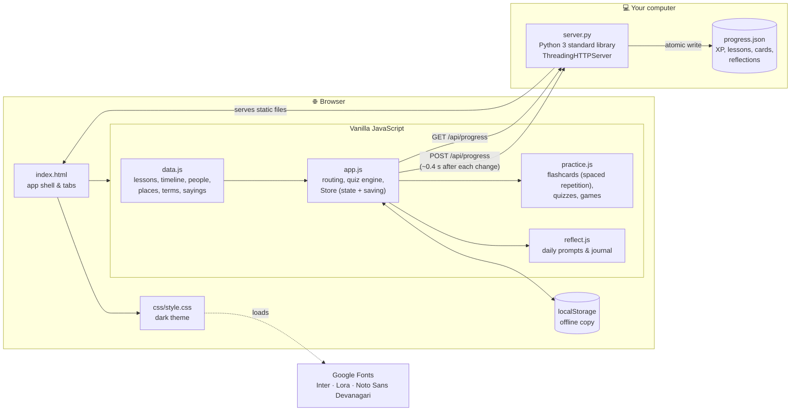

# Sai Path

A beginner-friendly web app for learning about the life, stories and teachings of **Sai Baba of Shirdi** (c. 1838–1918). It has a dark theme and needs nothing beyond Python.

## Features

- **Lessons**: 12 story-centred lessons in 4 units (Meet Sai Baba, Teachings, Famous Stories, Legacy). Each ends with a quiz.
- **Timeline**: key events from c. 1838 to 1954, each labelled **History** or **Tradition**.
- **Teachings**: core principles, sayings, the eleven assurances (paraphrased), and the famous stories.
- **People & Places**: devotees, the sites of Shirdi, and a searchable glossary of key words.
- **Practice**: spaced-repetition flashcards, topic quizzes, a timeline ordering game, and a "History or tradition?" drill.
- **Reflect**: daily reflection prompts and a private journal.
- **Progress**: XP, streak, activity chart, and mastery by topic. Progress saves automatically to `progress.json`, and you can download or restore backups.

## Run it

```bash
python server.py
```

Then open <http://localhost:8766>.

## Tech stack

Plain HTML, CSS and JavaScript in the browser, and one small Python file on your computer. There is no framework, no build step, and nothing to install.



**How saving works:** each change goes to `localStorage` straight away. About 0.4 seconds later it is also sent to `server.py`, which writes `progress.json` atomically, so a save is never left half-written. When the app starts, it loads both copies and keeps the newer one. If you open `index.html` without the server, the app still works and saves in the browser only.

| Layer | Technology |
| --- | --- |
| UI | HTML5, CSS custom properties (dark theme), hash-based tab routing |
| Logic | Vanilla JavaScript (ES2020), no dependencies |
| Learning engine | Leitner-style spaced repetition and generated multiple-choice quizzes |
| Fonts | Google Fonts: Inter, Lora, Noto Sans Devanagari |
| Server | Python 3 standard library (`http.server`) |
| Storage | `progress.json` on disk, plus `localStorage` as a backup |

## Project layout

```
index.html        app shell and tabs
css/style.css     dark theme
js/data.js        all learning content
js/app.js         state & saving, routing, quiz engine, most tabs
js/practice.js    flashcards, quizzes, timeline game, history-vs-tradition drill
js/reflect.js     reflection prompts and journal
server.py         static server + progress save API
```

## About the content

The content is based mainly on the *Shri Sai Satcharitra* by Hemadpant, plus general historical sources. Devotional accounts are clearly marked as tradition. Sayings and the eleven assurances are paraphrased, because wording differs between translations.
